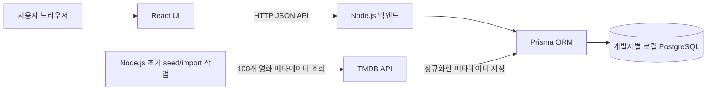

# 시스템 아키텍처

> 구조와 구현 상태를 함께 기록한다. Figma에는 회원가입/로그인 화면은 없지만 상세 화면에 비로그인 펀딩 입력 및 코멘트 수정 UI가 있다. 화면 설계와 등록 API/DB 동작 결정은 별개다. 팀원별 Docker 환경의 PostgreSQL과 공통 schema/migration/seed를 사용한다. 운영 DB 구성은 미정이다.

> 이 저장소에는 Node.js/Express 서버, Movie/Funding 분리 Prisma schema와 migration, PostgreSQL Compose 및 영화 JSON seed가 있다. HTTP 경계는 `routes/`, 도메인 규칙은 `services/`, Prisma 쿼리는 `repositories/`에서 담당한다. 프런트엔드는 별도 `cine-fund` 저장소에서 관리한다.

## 구성도



각 개발자는 위 애플리케이션 구성을 자신의 Docker 개발 환경에서 실행한다. 로컬 PostgreSQL 데이터는 개발자별로 독립적이며 팀원 간 DB 서버를 공유하지 않는다. 팀이 공유하는 것은 Prisma schema, 마이그레이션, seed 절차다. 통합/운영 환경의 공용 DB는 별도 결정 사항이다.

## 경계와 데이터 흐름

- React는 화면과 사용자 입력을 담당하며 API를 통해 서버와 통신한다. 브라우저에서 PostgreSQL에 직접 접속하지 않는다.
- Express route는 요청 경로·상태 코드와 입력 검증을 담당하고 service는 조회·펀딩 규칙을 조합한다. Repository는 Prisma 접근을 한곳에 모으고 service에 DB 모델 세부사항이 퍼지지 않도록 한다.
- Prisma는 백엔드에서 PostgreSQL 조회/수정 및 트랜잭션을 수행하는 ORM이다. Movie DB와 Funding DB에 별도 schema/client를 사용하며 DB 접근은 `src/repositories/`에서 담당한다.
- 로컬 PostgreSQL 컨테이너 하나 안에 `cinefund` 영화 DB와 `funding` 펀딩 DB를 둔다. 두 DB 사이에는 외래 키가 없으므로 서버가 영화 존재를 확인하고 Funding을 `movieId`로 연결한다.
- `totalFundedAmount`는 Funding 원장의 `amount`를 `movieId`별 합산해 API 응답에 만든다. Movie DB에 중복 누적액을 저장하지 않는다.
- TMDB API 키는 Node.js seed/import 실행 환경의 비밀 변수로 보관한다. PostgreSQL 자체가 TMDB를 호출하는 것이 아니라 import 스크립트가 TMDB 응답을 받아 Prisma로 저장한다. 지정 100편 메타데이터는 DB에서 제공하며 앱 화면 요청 때 TMDB를 실시간 호출하지 않는다. 갱신 시점/책임은 TBD다.
- 로컬 개발에서는 각자의 PostgreSQL 컨테이너를 사용한다. FE/BE 컨테이너와 DB 컨테이너를 함께 실행할지, FE/BE를 호스트에서 실행하고 DB만 컨테이너화할지는 저장소 설정 단계에서 확정한다.
- Prisma schema와 커밋된 migration이 DB 구조의 기준이다. 새 팀원은 같은 migration을 적용하고 필요한 초기 영화 데이터는 seed 절차로 입력한다. 개인 DB 데이터를 서로 주고받아 구조를 맞추지 않는다.

## 서버 디렉터리 경계

```text
src/
  config/       # DB 연결, 서버 설정, 검증 제한값
  errors/       # 공통 애플리케이션 오류
  middlewares/  # CORS, 404, 오류 응답
  repositories/ # Movie/Funding Prisma 쿼리
  routes/       # HTTP 경로와 요청/응답 연결
  services/     # 도메인 규칙과 repository 조합
  utils/        # 응답 변환, cursor, 페이지 정렬
  validators/   # 공통·영화·펀딩·비교 요청 검증
  movies/       # TMDB 영화 선정과 데이터 적재
```

Route는 Prisma를 직접 호출하지 않는다. Service는 HTTP 요청/응답 객체를 받지 않으며, Repository는 입력 정책이나 응답 형태를 결정하지 않는다. 이 경계를 유지해 DB와 API 표현 변경이 서로 번지지 않게 한다.

## 주요 흐름

### 영화 조회

1. React가 `GET /api/movies?limit=...&cursor=...` 호출
2. Route가 query를 검증하고 Movie service를 호출한다.
3. Movie repository가 영화 정보를, Funding repository가 영화 ID별 원장 합계를 조회한다.
4. Service가 정렬·cursor 페이지를 구성하고 공통 응답 모델로 변환한다.
5. API JSON을 반환하고 React는 로딩/빈/오류/목록 상태를 표시한다.

영화 메타데이터는 사전 seed/import로 DB에 적재한 값을 사용한다. 사용자 요청에서 TMDB를 호출하지 않는다.

기본 랜덤 목록은 cursor에 seed와 offset을 담아 페이지 사이에서 순서를 유지한다. 검색·금액·달성률 정렬은 offset을 사용한다. 금액·달성률 정렬 중 펀딩이 추가되면 순위가 바뀌어 페이지 간 중복·누락이 생길 수 있다.

코멘트 조회(`GET /api/movies/{movieId}/comments`)는 값이 바뀌지 않는 `createdAt`, `fundingId`를 정렬 기준으로 쓰므로, cursor에 마지막 코멘트의 위치(`movieId`, `createdAt`, `fundingId`)를 담는다. 새 코멘트가 추가되어도 페이지 사이에 중복·누락이 생기지 않는다. 서버는 `limit + 1`개를 조회해 다음 페이지 유무를 판단한다.


### 익명 펀딩 생성

1. React가 금액, 닉네임, 코멘트, 비밀번호를 POST
2. Route가 요청값을 검증하고 Funding service를 호출
3. Movie repository에서 대상 영화 존재 여부를 확인
4. 비밀번호를 해시하고 Funding repository transaction에서 원장 행 생성과 합계 재집계
5. 응답 변환에서 비밀번호와 해시를 제외

### 펀딩 변경과 코멘트 수정

취소와 코멘트 수정은 Funding service가 저장된 비밀번호 해시를 확인한 뒤에만 수행한다. 삭제와 누적액 재집계는 Funding repository transaction 안에서 처리한다. 비밀번호 오류는 403으로 응답하며 원문 비밀번호와 해시를 API 응답이나 서버 로그에 포함하지 않는다.

## 오류 및 환경변수

TMDB seed/import 작업의 timeout/실패, DB 오류, 입력 오류를 구분해 처리한다. 앱 API 오류는 내부 stack trace와 비밀을 응답하지 않고 서버 로그에도 비밀번호를 남기지 않는다. 환경변수는 `DATABASE_URL`, `FUNDING_DATABASE_URL`, `TMDB_API_KEY` 또는 `TMDB_API_TOKEN`, `PORT`, `CORS_ORIGINS`를 사용한다. `.env`는 커밋하지 않고 `.env.example`에 로컬 개발 예시만 둔다. 배포 환경의 secret manager/환경변수 설정은 플랫폼 결정 후 문서화한다.

로컬 Docker 설정에서는 DB 연결 주소가 실행 위치에 따라 달라진다. 백엔드도 컨테이너 안에서 실행하면 Compose 서비스 이름을 호스트로 사용하고, 백엔드가 호스트에서 실행되면 공개한 로컬 포트를 사용한다. 실제 변수값은 환경별로 설정하며 팀에 비밀키나 개인 `.env` 파일을 공유하지 않는다. TMDB 요청은 준비 단계의 서버 측 seed/import에서만 수행하고 `TMDB_API_KEY`를 프런트엔드 컨테이너/번들에 넣지 않는다.
