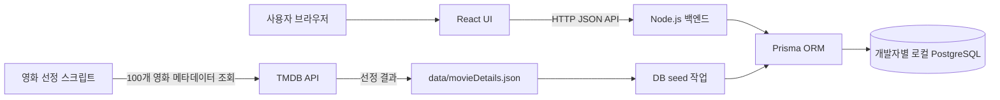

# 시스템 아키텍처

> 구조와 구현 상태를 함께 기록한다. Figma에는 회원가입/로그인 화면은 없지만 상세 화면에 비로그인 펀딩 입력 및 코멘트 수정 UI가 있다. 화면 설계와 등록 API/DB 동작 결정은 별개다. 팀원별 Docker 환경의 PostgreSQL과 공통 schema/migration/seed를 사용한다. 운영 DB 구성은 미정이다.

> 2026-10-23 코드 기준: 이 저장소에는 Node.js/Express 서버, Prisma schema와 migration, PostgreSQL Compose, 영화 JSON seed, 조회·비교·랭킹 API 및 모의 펀딩 생성·취소·코멘트 수정 API가 있다. 펀딩 API는 원장과 영화 누적액을 트랜잭션으로 갱신하고 비밀번호를 scrypt 해시로 저장한다. DB/HTTP 통합 검증과 별도 `cine-fund` 프런트엔드 연동 완료 여부는 확인되지 않았다.

## 구성도

각 개발자는 위 애플리케이션 구성을 자신의 Docker 개발 환경에서 실행한다. 로컬 PostgreSQL 데이터는 개발자별로 독립적이며 팀원 간 DB 서버를 공유하지 않는다. 팀이 공유하는 것은 Prisma schema, 마이그레이션, seed 절차다. 통합/운영 환경의 공용 DB는 별도 결정 사항이다.

## 경계와 데이터 흐름

- React는 화면과 사용자 입력을 담당하며 API를 통해 서버와 통신한다. 브라우저에서 PostgreSQL에 직접 접속하지 않는다.
- Node 서버는 화면의 조회 API, 입력 검증, 도메인 규칙, 오류 변환을 담당한다. 현재는 `GET /health`와 영화 목록·상세·비교·코멘트 조회·랭킹 전용 조회 API가 구현되어 있다. 초기 영화 선정은 별도 스크립트가 TMDB를 호출하고, DB seed는 고정 JSON을 읽는다.
- Prisma는 백엔드에서 PostgreSQL 조회/수정 및 트랜잭션을 수행하는 ORM이다. list/funding은 논리적 데이터 영역이며 두 DB를 뜻하지 않는다.
- PostgreSQL은 핵심 영화 데이터와 모의 펀딩 기록 관계를 보관하는 구조를 목표로 한다. 구체 테이블/집계 방식은 별도 DB/API 합의 사항이다.
- TMDB 인증정보는 영화 재선정 실행 환경의 비밀 변수로 보관한다. `movies:select`가 TMDB 응답을 고정 JSON으로 저장하고, `db:seed`는 인증정보 없이 JSON만 읽어 Prisma로 저장한다. 지정 100편 메타데이터는 DB에서 제공하며 앱 화면 요청 때 TMDB를 실시간 호출하지 않는다. 갱신 시점/책임은 TBD다.
- 로컬 개발에서는 각자의 PostgreSQL 컨테이너를 사용하며 현재 백엔드는 호스트에서 실행한다. FE/BE 컨테이너화와 운영 구성은 별도 결정 사항이다.
- Prisma schema와 커밋된 migration이 DB 구조의 기준이다. 새 팀원은 같은 migration을 적용하고 필요한 초기 영화 데이터는 seed 절차로 입력한다. 개인 DB 데이터를 서로 주고받아 구조를 맞추지 않는다.

## 주요 흐름

### 영화 조회

1. React가 `GET /api/movies?limit=...&cursor=...` 호출
2. 서버가 입력 검증 후 Prisma로 영화 정보와 저장된 `totalFundedAmount`를 조회한다. 달성률은 정렬에 사용하며 별도 응답 필드로 반환하지 않는다. 필드·계산 규칙은 [API 명세](API_SPEC.md)를 따른다.
3. 영화 메타데이터는 사전 seed/import로 DB에 적재된 값을 사용한다. TMDB에 없는 값은 NULL/기본 표시 정책을 따른다.
4. API 표준 JSON 반환, React는 로딩/빈/오류/목록 상태를 표시

기본 랜덤 목록은 첫 요청의 seed와 다음 시작 위치(offset)를 cursor에 담아 같은 영화 집합의 순서를 페이지 간 유지한다. 제목 검색과 명시적 금액·달성률 정렬은 offset을 사용한다. 목록 API에서 금액·달성률 정렬 중 누적액이 바뀌면 순위가 이동해 페이지 사이 중복·누락이 생길 수 있다. 랭킹 화면은 이 목록 cursor와 다른 전용 cursor를 사용한다.

### 랭킹 조회

1. React가 `GET /api/rankings?limit=10&sortBy=amount&order=desc`를 호출한다. 후속 요청에는 이전 `page.nextCursor`를 같은 조건으로 전달한다.
2. `src/routes/rankings.js`의 `rankingRoutes`가 `limit`, `sortBy`, `order`를 검증한다.
3. `rankingService`가 Prisma로 최신 영화 데이터를 조회하고 `rankingPage`를 호출한다.
4. `rankingPage`는 후속 요청의 cursor를 `rankingCursor`로 검증·해석하고, 최신 정렬 결과에서 `seenIds`에 있는 영화를 제외한다. 다음 항목이 있으면 이번에 반환한 ID도 누적하여 cursor를 만든다.
5. `rankingService`가 공통 영화 응답 모델로 변환해 `{ items, page: { nextCursor, hasMore } }`를 반환한다.

처리 흐름은 `rankingRoutes → rankingService → rankingPage → rankingCursor`이며 정렬·응답 변환은 기존 `movieSort`, `movieResponse`를 재사용한다.

| 항목 | 영화 목록 API | 랭킹 API |
|---|---|---|
| 경로 | `/api/movies` | `/api/rankings` |
| cursor | offset 기반; 랜덤은 seed도 포함 | seenIds 기반; 요청 조건과 버전도 포함 |
| 금액 변경 시 | 금액·달성률 정렬에서 중복·누락 가능 | 이미 조회한 영화를 제외하고 나머지를 최신 기준으로 정렬 |
| 순위 고정 | 금액·달성률 순위 고정 안 함; 기본 랜덤 순서는 seed로 유지 | 최초 순위 고정 안 함 |

두 API 모두 cursor에 상태를 담으며 서버에 조회 세션을 저장하지 않는다. 랭킹은 서버가 발급한 cursor를 순서대로 사용하고 영화 집합이 고정된 경우 각 영화가 한 번씩 반환된다. 금액이 바뀌면 여러 페이지를 합친 전체 정렬 순서는 보장하지 않는다. 정렬 조건·페이지 크기를 바꾸거나 최신 전체 순위를 다시 조회할 때는 cursor를 초기화한다. 랭킹 cursor의 400 조건과 현재 검증 한계는 [API 명세](API_SPEC.md#랭킹-전용-조회)를 따른다.

### 코멘트 조회

코멘트 조회(`GET /api/movies/{movieId}/comments`)는 값이 바뀌지 않는 `createdAt`, `fundingId`를 정렬 기준으로 쓰므로, cursor에 마지막 코멘트의 위치(`movieId`, `createdAt`, `fundingId`)를 담는다. 새 코멘트가 추가되어도 페이지 사이에 중복·누락이 생기지 않는다. 서버는 `limit + 1`개를 조회해 다음 페이지 유무를 판단한다.

### 익명 펀딩 참여 UI와 등록 흐름 (서버 계약은 제안)

> 비로그인·무결제 모의 펀딩은 서비스 목표다. 아래는 그 기능을 처리하는 서버 흐름의 검토안이다. UI와 기능 목표는 유지하고, 구체적인 입력 검증·endpoint·저장/수정 권한은 API 담당자와 합의하기 전 제안으로 둔다.

1. React가 금액, 닉네임, 코멘트, 비밀번호를 POST
2. 서버가 영화 존재 여부와 모든 입력을 검증
3. 비밀번호 해시 생성 후 트랜잭션에서 Funding 원장 기록
4. 응답은 비밀 값 제외. 누적 금액을 재집계하거나 동시성 안전하게 갱신

### 코멘트 수정 (구현 흐름 및 남은 정책 결정)

1. 클라이언트가 `fundingId`, 비밀번호, 새 코멘트로 PATCH
2. 서버가 기록을 조회하고 해시와 비밀번호 비교
3. 일치할 때에만 코멘트를 갱신. 틀리면 일반화된 401/403 오류 응답
4. 시도 횟수 제한과 해시 비용 강화 여부는 공개 전 검토

## 오류 및 환경변수

영화 선정 작업의 timeout/실패, DB 오류, 입력 오류를 구분해 처리한다. 앱 API 오류는 내부 stack trace와 비밀을 응답하지 않고 서버 로그에도 비밀번호를 남기지 않는다. 실제 환경변수는 다음과 같다.

| 변수 | 용도 |
|---|---|
| `DATABASE_URL` | Prisma/PostgreSQL 연결 주소; 서버·migration·seed에서 사용 |
| `TMDB_API_KEY` 또는 `TMDB_API_TOKEN` | 영화 재선정(`movies:select`)에만 사용; DB seed와 앱 API 요청에서는 불필요 |
| `PORT` | 서버 수신 포트; 생략하면 3000 |
| `CORS_ORIGINS` | 허용할 프런트엔드 origin 목록; 쉼표로 구분하며 비어 있으면 다른 origin을 허용하지 않음 |

`.env`는 커밋하지 않는다. `.env.example`에는 로컬 개발용 연결 예시와 빈 TMDB 인증정보 항목을 제공한다. 배포 환경의 비밀정보 설정은 플랫폼 결정 후 문서화한다.

로컬 Docker 설정에서는 DB 연결 주소가 실행 위치에 따라 달라진다. 현재 Compose는 PostgreSQL을 `127.0.0.1:5435`에 공개하며 백엔드는 호스트에서 실행한다. 백엔드도 컨테이너화한다면 DB 연결 주소를 해당 구성에 맞게 정해야 한다. 실제 변수값은 환경별로 설정하며 팀에 비밀키나 개인 `.env` 파일을 공유하지 않는다. TMDB 요청은 영화 선정 스크립트에서만 수행하고 TMDB 인증정보를 프런트엔드 컨테이너/번들에 넣지 않는다.
