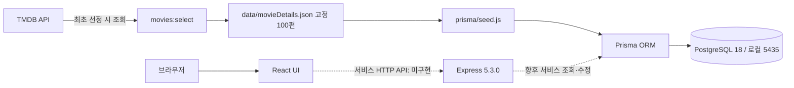

# 시스템 아키텍처

> 애플리케이션 구조 초안(2026-10-19 백엔드 코드 기준). Figma의 비로그인 펀딩/코멘트 수정 UI와 **실제 구현된 API**는 구분한다. 이 ZIP에는 Express 5.3.0 서버 골격, Prisma 7.10.0, Docker PostgreSQL 18, 영화 100편 JSON·시드가 있고 운영 DB와 배포는 미확정이다.

> 과거 확인한 팀 GitHub `main`에는 FE의 `client/` scaffold가 있었다. **현재 ZIP**에는 BE 준비 코드가 있으나 `main` 병합 여부는 별도 확인해야 한다. 아래 **영화 데이터 선정·시드**는 코드가 있고, **영화/펀딩 서비스 요청**은 제안 단계(`GET /health`만 구현)다.

## 구성도

각 개발자는 위 애플리케이션 구성을 자신의 Docker 개발 환경에서 실행한다. 로컬 PostgreSQL 데이터는 개발자별로 독립적이며 팀원 간 DB 서버를 공유하지 않는다. 팀이 공유하는 것은 Prisma schema, 마이그레이션, seed 절차다. 통합/운영 환경의 공용 DB는 별도 결정 사항이다.

## 경계와 데이터 흐름

- React는 화면과 사용자 입력을 담당하며 API를 통해 서버와 통신한다. 브라우저에서 PostgreSQL에 직접 접속하지 않는다.
- Node/Express 서버는 현재 `GET /health`만 구현한다. 앞으로 화면 조회·입력 검증·오류 변환을 구현할 예정이다. **TMDB를 호출하는 것은 `pnpm movies:select`**이며 `pnpm db:seed`는 JSON만 읽는다.
- Prisma는 백엔드에서 PostgreSQL 조회/수정 및 트랜잭션을 수행하는 ORM이다. list/funding은 논리적 데이터 영역이며 두 DB를 뜻하지 않는다.
- PostgreSQL에는 현재 스키마·마이그레이션 기준 `Movie`와 `Funding` 관계가 정의되어 있다. `Movie.totalFundedAmount`는 집계용 컬럼이지만 **후원 생성과 함께 안전하게 증가시키는 API는 아직 구현되지 않았다**.
- TMDB API 키는 Node.js 영화 **재선정 스크립트**의 환경변수로만 보관한다. TMDB → `movies:select` → `data/movieDetails.json` → `prisma/seed.js` → Prisma → PostgreSQL 순서다. 팀원 시드는 TMDB 키 불필요하며 JSON이 존재하면 재선정으로 덮어쓰지 않는다. 영화 최소 제작비는 25,000 USD(선정용 고정 환율로 3,500만 원 상당)이다. 메타데이터 갱신 시점/책임은 TBD다.
- 현재 Compose 설정은 **DB 컨테이너만** 실행하고 Node/Express는 호스트에서 `pnpm dev`로 실행한다. FE 컨테이너화나 배포 구조는 팀에서 추후 결정한다.
- `prisma/schema.prisma`와 초기 생성·목표액 컬럼 제거 마이그레이션 이력이 DB 구조의 기준이다. 새 팀원은 `pnpm db:up` → `pnpm db:migrate` → `pnpm db:generate` → `pnpm db:seed` → `pnpm test:db`를 실행한다. 시드는 기존 누적액·후원 원장은 유지하고 고정 목록 외 영화가 있으면 중단한다. 개인 DB 데이터를 서로 주고받아 구조를 맞추지 않는다.

> **통화 정책:** `productionBudget`은 TMDB USD 원본, `Funding.amount`와 `totalFundedAmount`는 KRW다. 고정 환율 1,400원은 영화 선정 최소 제작비 검증용이며 펀딩 목표액을 생성하지 않는다. 달성률은 별도 목표 기준이 합의되기 전까지 계산하지 않는다. 기존 데이터에서 후원액 통화가 불분명하면 시드 전 확인한다.

## 주요 흐름 (서비스 API는 아직 미구현)

### 영화 조회

1. React가 `GET /api/movies?limit=...&cursor=...` 호출
2. 서버가 입력 검증 후 Prisma로 영화 정보와 모의 펀딩 누적액을 조회 (응답 필드 계약 TBD)
3. 영화 메타데이터는 사전 seed/import로 DB에 적재된 값을 사용한다. TMDB에 없는 값은 NULL/기본 표시 정책을 따른다.
4. API 표준 JSON 반환, React는 로딩/빈/오류/목록 상태를 표시

기본 랜덤 순서가 페이지 요청마다 변하면 누락/중복이 생길 수 있다. 제안은 첫 목록의 순서를 고정하고 cursor와 함께 유지하는 것이며, 쿠키/localStorage를 쓰지 않는 제약 아래 stateless seed 또는 서버 저장 방식 중 팀 결정이 필요하다.

### 익명 펀딩 참여 UI와 등록 흐름 (서버 계약은 제안)

> 비로그인·무결제 모의 펀딩은 서비스 목표다. 아래는 그 기능을 처리하는 서버 흐름의 검토안이다. UI와 기능 목표는 유지하고, 구체적인 입력 검증·endpoint·저장/수정 권한은 API 담당자와 합의하기 전 제안으로 둔다.

1. React가 금액, 닉네임, 코멘트, 비밀번호를 POST
2. 서버가 영화 존재 여부와 모든 입력을 검증
3. 비밀번호 해시 생성 후 트랜잭션에서 Funding 원장 기록
4. 응답은 비밀 값 제외. 누적 금액을 재집계하거나 동시성 안전하게 갱신

### 코멘트 수정 (세부 정책/API 합의가 필요한 제안 흐름)

1. 클라이언트가 `fundingId`, 비밀번호, 새 코멘트로 PATCH
2. 서버가 기록을 조회하고 해시와 비밀번호 비교
3. 일치할 때에만 코멘트를 갱신. 틀리면 일반화된 401/403 오류 응답
4. 시도 횟수 제한과 비밀번호 해시 알고리즘/비용은 구현 전 결정

## 오류 및 환경변수

TMDB 선정 스크립트에는 timeout/재시도 코드가 있으나 실제 장애 상황별 검증은 별도 필요하다. DB 연결 및 영화 100편 일치는 `pnpm test:db`로 검증한다. 서비스 API의 입력·오류 처리와 후원 트랜잭션은 아직 구현 전이다. 향후 서비스 API의 오류에는 내부 stack trace와 비밀을 노출하지 않고 서버 로그에도 비밀번호를 남기지 않도록 구현해야 한다. 환경변수: `.env.example`에 로컬 접속용 `DATABASE_URL` 예시와 빈 `TMDB_API_KEY`/`TMDB_API_TOKEN`이 있으며, `PORT`는 서버의 선택값(기본 3000)이다. `CLIENT_ORIGIN`은 향후 CORS 구현 시 결정할 제안이고 현재 사용되지 않는다. 개인 `.env`는 커밋하지 않는다. 배포 환경의 secret manager/환경변수 설정은 플랫폼 결정 후 문서화한다.

현재 Compose는 **PostgreSQL만** 컨테이너로 실행하고 Express는 호스트에서 `pnpm dev`로 실행한다. 이때 DB는 `127.0.0.1:5435`로 접속한다. 향후 백엔드까지 컨테이너화한다면 Compose 서비스 호스트명 등 연결 설정을 별도로 변경해야 한다. 실제 변수값은 환경별로 설정하며 팀에 비밀키나 개인 `.env` 파일을 공유하지 않는다. TMDB 요청은 서버 측 `movies:select`에서만 수행하고 `TMDB_API_KEY`/`TMDB_API_TOKEN`을 프런트엔드 컨테이너/번들에 넣지 않는다.
