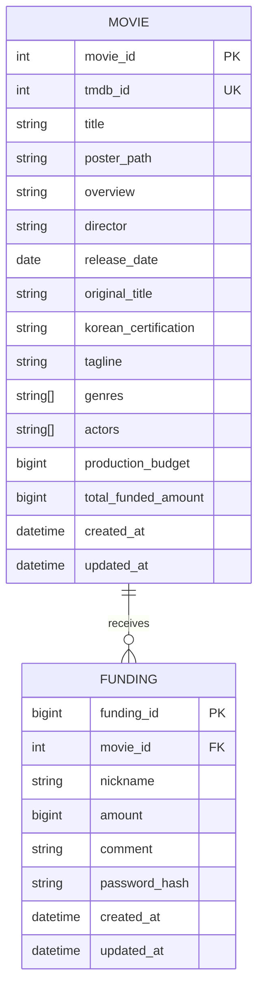

# 데이터베이스 스키마 초안

> 이 문서는 현재 구현과 팀 검토용 제안을 함께 기록한다. **DB 구조의 실제 기준은 `prisma/schema.prisma`와 `prisma/migrations/`**이며, 아래 "테이블 제안"의 TBD 항목이 모두 구현되었다는 뜻은 아니다. `list DB`, `funding DB`는 논리 영역이다. 영화 100편은 `data/movieDetails.json`에서 seed로 적재하며, TMDB 재조회는 별도 선정 스크립트에서 수행한다. 팀원은 각자 로컬 PostgreSQL을 실행하고 같은 migration·seed 절차를 따른다.

## 현재 구현과 미확정 항목

`prisma/schema.prisma`는 이 문서의 관계/식별자 구조(movie 내부 PK와 고유 tmdb_id, funding FK, 후원 원장)를 반영한다. 이는 문서 전체를 팀 확정 규격으로 승격한 뜻은 아니다. 다음 항목은 팀 결정 전 임의 적용하지 않는다.

- `genres`는 현재 저장된 PostgreSQL `TEXT[]`를 유지한다. 문서의 JSONB 또는 정규화 제안은 TBD다.
- 영화 100편은 **제작비 최소 3,500만 원 상당**인 작품만 선정한다. 선정용 고정 환율은 **1 USD = 1,400 KRW**이므로 TMDB 제작비(`budget`)가 **25,000 USD 이상**이어야 한다. 제작비 0·미상·기준 미달 영화는 선정/시드에서 제외한다. 선정 영화의 제작비 원본(USD)은 `production_budget`에 저장하고 후원액·누적액은 KRW로 관리한다. 펀딩 목표액은 별도로 저장하지 않는다.
- 현재 후원 코멘트는 스키마상 필수이며 `Funding.comment`도 `NOT NULL`로 유지한다. 빈 문자열(빈 코멘트)을 API에서 허용할지는 TBD다.
- `originalTitle`과 `koreanCertification`은 `20261018092607_init` 마이그레이션에 이미 반영된 nullable 컬럼이다. 이번 변경은 `20261019120000_remove_funding_goal` 마이그레이션으로 목표액 컬럼만 제거하며, 기존 init SQL은 변경하지 않는다.
- 금액 양수 CHECK, 최소/최대 금액, 원장 합계의 자동 일관성 보장 방식은 서버/API 합의 전 추가하지 않는다.
- `budget_currency`는 기존 데이터에 근거해 명시적으로 확정할 수 없어 아직 컬럼으로 만들지 않았다.
- 현재 migration은 `fundings.created_at TIMESTAMPTZ(3)`로 신규 테이블을 생성한다. 과거 DB의 `funded_at TIMESTAMP` 같은 레거시 데이터가 실제로 있다면 별도의 이전·시각대 검증이 필요하며, 이번 ZIP의 마이그레이션이 자동 변환한다고 가정하지 않는다. 운영 DB는 적용 전 백업·정합성을 별도 확인한다.

## 관계



## 테이블 제안

| 테이블.컬럼 | 타입 제안 | 제약/설명 |
|---|---|---|
| Movie.movie_id | SERIAL/INTEGER | PK 내부 ID |
| Movie.tmdb_id | INTEGER | UNIQUE NOT NULL, 외부 식별자 |
| Movie.title | TEXT | NOT NULL (현재 PostgreSQL 타입) |
| Movie.poster_path | TEXT | NULL 허용. TMDB 포스터 경로가 현재 JSON/DB에 저장됨 |
| Movie.overview | TEXT | NULL 허용. 영화 설명이 현재 JSON/DB에 저장됨 |
| Movie.director | TEXT | NULL 허용. `credits`의 감독명(복수인 경우 `, `로 연결)이 현재 JSON/DB에 저장됨 |
| Movie.release_date | DATE | NULL 허용 |
| Movie.genres | TEXT[] | **현재 구현**: `String[] @default([])`; JSONB/정규화는 향후 TBD |
| Movie.actors | TEXT[] | **현재 구현**: `String[] @default([])`; TMDB `credits.cast`의 출연 배우 이름 최대 10명 |
| Movie.original_title | TEXT | **현재 구현**: nullable, TMDB 원제 (`originalTitle`) |
| Movie.korean_certification | TEXT | **현재 구현**: nullable, 한국 관람 등급 (`koreanCertification`) |
| Movie.tagline | TEXT | NULL 허용 |
| Movie.production_budget | BIGINT | NULL 가능, TMDB 값 USD 기준, 환산하지 않고 숫자 저장 |
| Movie.budget_currency | CHAR(3) **제안** | 현재 미구현; 통화 보존 컬럼 추가 여부 TBD |
| Movie.total_funded_amount | BIGINT | KRW, NOT NULL DEFAULT 0; 초기 적재 시 0. 테스트용 펀딩 기록을 추가하면 합계와 일치하도록 갱신 |
| Movie.created_at / updated_at | TIMESTAMPTZ | NOT NULL, 기본 현재 시각 |
| Funding.funding_id | BIGSERIAL | PK (`Funding.fundingId`: Prisma BigInt) |
| Funding.movie_id | INTEGER | FK → Movie.movie_id, NOT NULL, 삭제 정책 restrict 제안 |
| Funding.nickname | VARCHAR(8) | **현재 구현** NOT NULL; trim·빈값 검사는 추후 API 검증 규칙 |
| Funding.amount | BIGINT | KRW, **현재 구현** NOT NULL. `CHECK(amount > 0)`은 미구현 제안, 최소/최대 TBD |
| Funding.comment | VARCHAR(100) | **현재 구현** NOT NULL. 빈 문자열 허용 여부/검증은 TBD |
| Funding.password_hash | TEXT | NOT NULL, 검증 가능한 강한 단방향 해시만 저장 |
| Funding.created_at / updated_at | TIMESTAMPTZ | NOT NULL; 최신순 기준은 created_at, funding_id tie-break |

외부 TMDB 식별자에는 `tmdb_id` 컬럼명을 API/DB에서 사용한다. 영화 선정 시 TMDB 제작비(`budget`)가 **25,000 USD 이상(고정 환율 1 USD = 1,400 KRW 기준 한화 3,500만 원 상당)**인 작품 100편만 포함하고, 제작비 0·미상·기준 미달 영화는 제외한다. 초기 seed는 검증된 USD 제작비 원본만 `production_budget`에 저장하고, 누적 후원액·후원 기록은 보존한다. 기존 DB를 마이그레이션할 때는 후원 데이터 백업과 통화를 확인한다.

## Prisma 모델 — 현재 구현 기준

아래 코드는 현재 `prisma/schema.prisma`의 **두 모델을 그대로 발췌**한 것이다. **수정할 때는 실제 `prisma/schema.prisma`를 먼저 변경하고 migration을 함께 관리**한다. 표의 `budget_currency`, `genres` JSONB/정규화, 후원 금액 CHECK 등은 팀 검토 제안(TBD)이며 아래 구현에 임의로 추가하지 않았다.

```prisma
model Movie {
  movieId             Int       @id @default(autoincrement()) @map("movie_id")
  tmdbId              Int       @unique @map("tmdb_id")
  title               String
  posterPath          String?   @map("poster_path")
  overview            String?
  director            String?
  releaseDate         DateTime? @map("release_date") @db.Date
  // Array storage is retained from the current DB until the schema draft's JSONB/normalization TBD is decided.
  genres              String[]  @default([])
  actors              String[]  @default([]) // 출연 배우 이름 (최대 10명)
  originalTitle       String?   @map("original_title")        // 영화 원제
  koreanCertification String?   @map("korean_certification")  // 한국 관람 등급
  tagline             String?
  productionBudget    BigInt?   @map("production_budget")
  totalFundedAmount   BigInt    @default(0) @map("total_funded_amount")
  createdAt           DateTime  @default(now()) @map("created_at") @db.Timestamptz(3)
  updatedAt           DateTime  @default(now()) @updatedAt @map("updated_at") @db.Timestamptz(3)
  fundings            Funding[]

  @@map("movies")
}

model Funding {
  fundingId    BigInt   @id @default(autoincrement()) @map("funding_id")
  movieId      Int      @map("movie_id")
  nickname     String   @db.VarChar(8)
  amount       BigInt
  comment      String   @db.VarChar(100)
  passwordHash String   @map("password_hash")
  createdAt    DateTime @default(now()) @map("created_at") @db.Timestamptz(3)
  updatedAt    DateTime @default(now()) @updatedAt @map("updated_at") @db.Timestamptz(3)
  movie        Movie    @relation(fields: [movieId], references: [movieId], onDelete: Restrict)

  @@index([movieId, createdAt, fundingId])
  @@map("fundings")
}
```

Prisma만으로 표현하지 않은 검증 항목(예: 금액 양수 CHECK)은 아직 팀 결정 전 제안이다. 컬럼 길이와 후원 금액 검증의 최종 정책은 서버/API 구현 시 합의한다.

## 집계, 동시성, 정책

> 현재 DB에는 포스터/설명/감독 및 `total_funded_amount` 컬럼이 구현되어 있다. 초기 데이터는 총액 0으로 시작한다. 실제 구현 시 원장 합계와 캐시 일관성 유지 방식을 팀이 검토한다.

- 원장은 `Funding.amount` 기록이며 `total_funded_amount`는 표시/정렬을 위한 집계값 제안이다. 값은 Funding 합계와 항상 일치해야 한다.
- 초기 영화 적재 시 `total_funded_amount=0`으로 둔다. 초기 Funding 원장 데이터가 없으면 누적액 0을 의미한다. 정렬 검증에 필요한 테스트 금액은 개발 전용 Funding fixture/seed로 넣고 실사용 데이터와 분리한다.
- Funding insert와 집계값 증가를 한 DB 트랜잭션에서 수행하고 동시 요청에서 원자적 증가/잠금을 사용한다. 읽기-계산-쓰기는 lost update를 일으킬 수 있다. 정기 재집계로 원장 합계와 검증하는 방안도 검토한다.
- 현재 스키마에는 펀딩 목표액이 없어 달성률을 계산하지 않는다. 달성률 UI/정렬이 필요한 경우 팀이 별도 목표 기준을 확정하고 DB/API를 재설계해야 한다.
- Movie 삭제는 FK 보호를 위해 기본 restrict 제안. Funding 삭제/수정(금액 변경)은 감사·집계 정책 결정 전 허용하지 않는 안을 제안한다. 코멘트 수정은 Funding.comment만 변경한다.
- 비밀번호 해시는 응답/로그 금지. salt/알고리즘 비용은 사용 라이브러리 검토 후 결정한다.

## 팀 개발 환경에서의 DB 동기화 제안

- 저장소의 Prisma schema와 migration 파일을 DB 구조의 단일 기준으로 관리한다. 로컬에서 schema를 임의로 수정해 migration 없이 사용하는 방식은 피한다.
- 각 팀원은 Docker로 자기 컴퓨터에 PostgreSQL을 실행하고 같은 migration을 적용한다. DB 데이터/볼륨은 개인 로컬 개발 데이터이므로 팀 공용 데이터로 취급하거나 Git에 올리지 않는다.
- 공통 영화 100편은 버전 관리 중인 `data/movieDetails.json`에서 `prisma/seed.js`가 읽어 저장한다. 선정 시 TMDB 조회는 `src/movies/selectMovies.js`에서 별도로 실행하는 절차이며, 팀원이 시드할 때마다 인기순 목록을 다시 뽑지 않는다. seed는 영화 메타데이터를 upsert하되 기존 누적 후원액·후원 기록은 덮어쓰지 않는다.
- `prisma/seed.js`는 고정 JSON을 읽으므로 TMDB API 키가 필요 없다. 영화 목록을 새로 선정할 때만 TMDB API 키를 로컬 환경변수에서 사용한다. 재선정 여부는 팀 합의 후 결정한다.
- 공유 DB가 필요한 통합 테스트/배포 환경은 로컬 개발 DB와 분리해 별도 선택·접근 통제한다. 로컬 `.env`의 `DATABASE_URL`과 API 키는 커밋하지 않고 `.env.example`에는 변수명과 설명만 둔다.
- 첨부된 DB 준비 코드의 개발 환경은 PostgreSQL 18, Docker Compose, 로컬 포트 5435이며 `pnpm db:up` → `pnpm db:migrate` → `pnpm db:generate` → `pnpm db:seed` → `pnpm test:db` 순으로 실행한다. 팀 저장소 `main`에 통합할 때는 팀 운영 설정을 별도로 확인한다.
